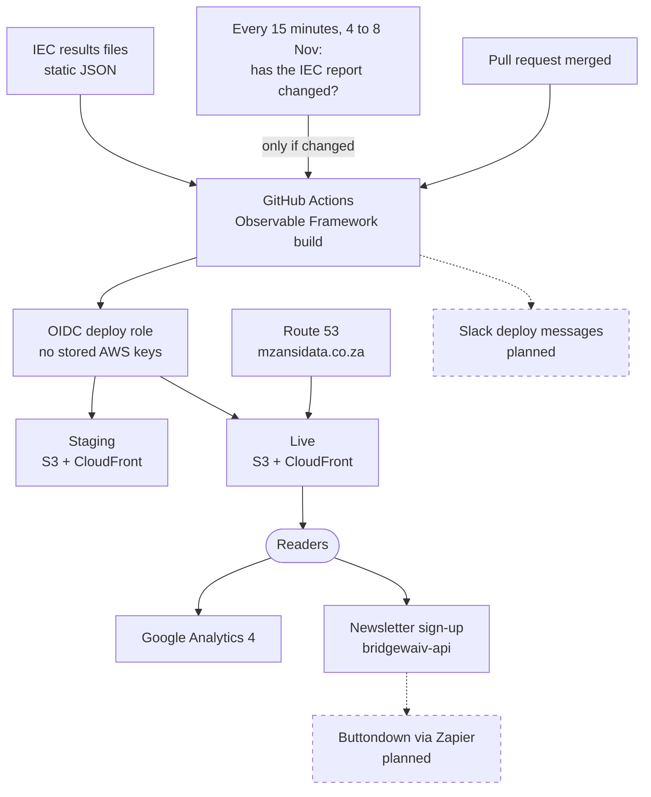
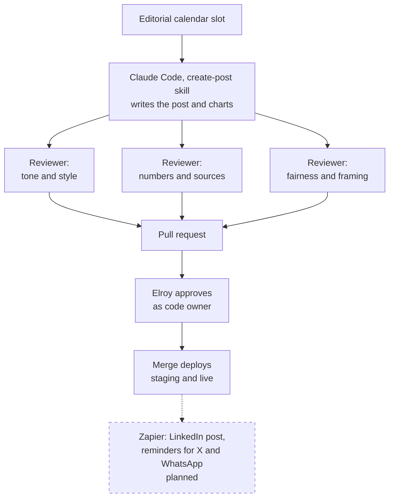

+++
title = "Building a South African data site with an AI team"
tags = [
    "ai",
    "data",
    "aws"
]
date = "2026-10-31"
description = "How a data catalogue, an election tracker and a publishing workflow for mzansidata.co.za came together in a few long sessions with Claude Code."
+++

South Africa publishes a remarkable amount of data about itself. Stats SA alone releases something most weeks, the Reserve Bank has decades of time series, Eskom reports electricity demand by the hour, and the IEC publishes election results down to each voting district. Most of it is read by a handful of specialists and then forgotten.

I wanted to see how far I could get, mostly by directing an AI rather than typing, towards a site that turns this material into charts for a general reader. The result is [MzansiData](https://mzansidata.co.za). It is live now with a tracker for the 2026 local government elections. The vote is on 4 November, and counting starts after the polls close. This post is about how it was built.

# Starting with a catalogue, not a website

The first request was simple: find the data. I asked Claude Code to survey what South Africa publishes regularly, plus affordable commercial sources, across economics, trade, politics, crime, the census, business, science and the weather.

It split the work across parallel research agents, one per area, and later added more when I asked for markets, payments, media and digital creators. They came back with 311 sources, each with its publisher, URL, release frequency, format, licence and a story idea. The useful part wasn't the list itself but the caveats that came with it:

- about a third of the sources publish only PDFs
- BankservAfrica's transaction index has been renamed
- there are no public radio ratings until 2027
- JIBAR ends this December
- the SAPS crime statistics site has an expired certificate

That kind of detail usually takes weeks of clicking to discover.

# The election tracker

The local elections were five days away, so the first real product had to be a results tracker. The IEC's API needs credentials, but it turns out the IEC's own results dashboard reads plain static JSON files. A file for the 2026 election already exists, empty, and fills up as the count progresses. That made a static site possible: a Python data loader fetches the IEC files at build time, condenses about 450 MB of per-municipality detail into 115 KB, and the page draws a map, the metros' seat counts and a list of "kingmaker" councils where no party has a majority.

Two details I liked. There's a demo mode that fakes a half-counted election from the 2021 results, so the live views could be tested before a single 2026 vote was counted. And the first version showed 91% turnout for 2021, because the IEC's "votes cast" counts every ballot paper and each voter casts two or three; that was caught on the first check in the browser.

The site is built with [Observable Framework](https://observablehq.com/framework/), which suits this kind of work. Pages are Markdown with JavaScript cells, and data loaders run at build time, so the output is plain static files.

# Hosting it like this blog

MzansiData is hosted the same way as this blog: S3 behind CloudFront, deployed from GitHub Actions through an AWS role that the workflow assumes with an OIDC token, so no AWS keys are stored anywhere. There are a few differences:

- the buckets are private and only CloudFront can read them
- the infrastructure is a CloudFormation template rather than hand-made
- a live deploy happens when a pull request is merged

# How the pieces fit together

*How the election data becomes a website, and how readers find it and follow it.*

The data comes in at build time. A Python loader fetches the IEC's static results files, so nothing on the site calls the IEC while you read it.

From 4 to 8 November, a scheduled run in GitHub Actions checks the IEC every 15 minutes. It compares the IEC's report timestamp with the one the live site was built from, and stops after a few seconds if nothing has changed. That keeps the whole count within the Actions minutes.

When there is something new, or a pull request has been merged, GitHub Actions builds the site with Observable Framework. The workflow then swaps an OIDC token for an hour on a deploy role that can only write to the two site buckets and clear the cache of the two CloudFront distributions. A merge updates staging and live together, and the scheduled run updates live only. Route 53 points mzansidata.co.za at the live distribution.

New posts arrive through the publishing workflow described below. Every change to `main` needs a pull request that I approve as the code owner.

Readers can sign up for the newsletter, which goes to the shared Bridgewaiv API for now. Buttondown, and automatic social posts through Zapier, come next. Google Analytics counts visits on the live site only.

# Teaching it not to sound like an AI

The first draft of the About page included the line "Every chart names its source." It's accurate, and it reads exactly like what it is: a machine-written slogan. So the project now has a `house-style` skill, which every piece of text has to follow. It sets out:

- neutral, evidence-first South African English
- a decimal comma and a space between thousands, as Stats SA does it
- rules for covering politically charged data without taking sides
- a list of patterns to avoid, based on Wikipedia editors' guide to spotting AI-written text: no em dashes, no "it's not X, it's Y", no groups of three, no "delve"

A small lint script enforces the mechanical parts.

# A publishing workflow with an adversarial review

*Every post is written by AI, checked by three independent AI reviewers and approved by me before it goes live.*

Each post follows a `create-post` skill. It takes a slot from a 52-week editorial calendar, fetches the data from the original publisher, writes the post and its charts, and records every number in a file that traces it back to the data.

Then three reviewers, each starting from a fresh context, attack the draft. One reads it as a sceptical South African reader who has seen too much AI copy. One recomputes every figure from the data. The third reads it as the spokesperson for whoever looks worst in the data, as the statistician at the agency that published it, and as a reader from a different community.

Their findings are recorded and resolved before a pull request is opened. A person, in this case me, approves the pull request, and the merge publishes the post.

Once a month, the workflow also reads Google Analytics and proposes changes to the calendar. Topics that do well become annual or quarterly regulars, but at least one slot in four stays reserved for topics the site hasn't covered yet. Otherwise you end up writing about load-shedding forever.

# What's next

The next step is to run the weekly workflow as an agent team on Claude Managed Agents: a scheduled run each week, an editor agent coordinating a data engineer, a source reader and the reviewers, an outcome grader that scores each draft against a rubric, and a dollar budget per run.

The agents get no access to AWS and can't merge anything. Social media will go through Zapier, which keeps the credentials and an audit trail outside the agents.

The interesting question for me isn't whether an AI can write a blog post; it obviously can. It's whether you can build enough structure around it (sources, checks, review, a human gate) for the result to be trustworthy enough to publish under your own name. Ask me again in a year.

# Follow along

The election tracker is at [mzansidata.co.za](https://mzansidata.co.za), and the results will start to fill in once counting begins after the vote on 4 November. To hear about new posts and charts:

- **Newsletter:** use the sign-up form on [mzansidata.co.za](https://mzansidata.co.za)
- **X:** [@mzansidata](https://x.com/mzansidata)
- **LinkedIn:** [MzansiData](https://www.linkedin.com/company/mzansidata)
- **WhatsApp:** the [MzansiData channel](https://whatsapp.com/channel/0029VbEMXU81t90W6pWUov3Q)

*MzansiData is a project by [Bridgewaiv](https://www.bridgewaiv.com), formerly Chat-Leads.*
